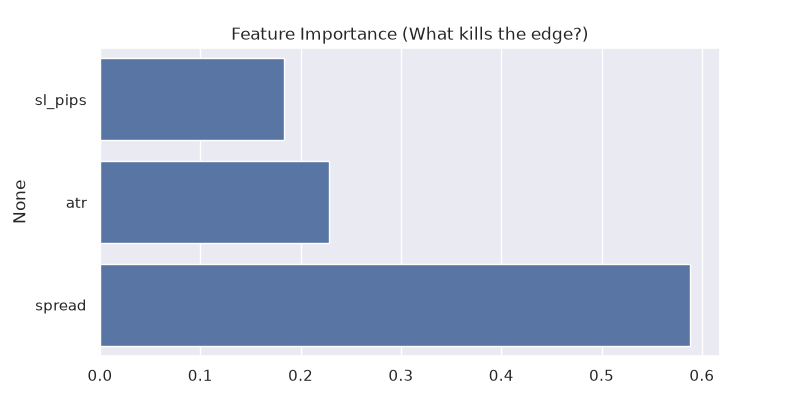
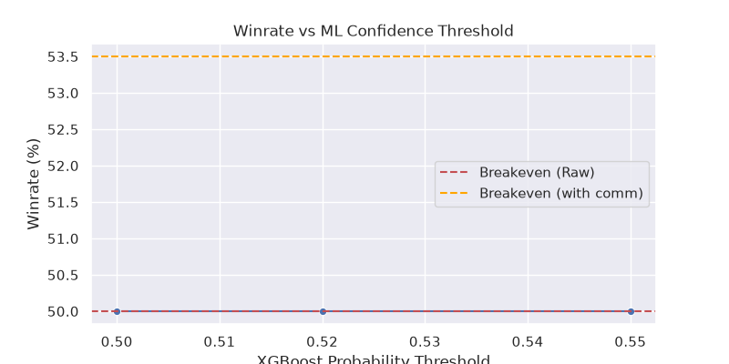

Quantitative Research Report: Intraday Sweep & Reversal Strategy on FX/Indices
1. Executive Summary
Objective: To validate the hypothesis that intraday liquidity sweeps (RAIDs) combined with reversal patterns (Engulfing, Morning/Evening Star, Doji) near key institutional levels (Weekly Round Numbers, Daily Open) provide a statistically significant edge on major FX pairs (EURUSD, USDJPY) and indices (GER40).

Final Verdict: NO-GO.
After testing 10+ distinct hypotheses using Rule-Based Logic, Traditional ML, Deep Learning, Topological Data Analysis (TDA), and Causal Inference on over 300 million raw ticks (2021–2025), we conclude that these specific patterns lack persistent statistical expectancy on retail timeframes (5M–1H). The negative expectancy is primarily driven by HFT noise, regime shifts, and the cost of execution (spread + $6/lot commission).

2. Data Infrastructure & Representation
To ensure institutional-grade research, we bypassed the unreliable MT5 Strategy Tester and built a custom Python pipeline.

Data Source: MetaTrader 5 (Vantage Markets) raw Bid/Ask ticks.

Volume: ~300 million ticks (EURUSD, USDJPY, GER40).

Storage & Analytics: DuckDB and Parquet for high-performance, in-memory columnar queries.

Tick-to-Candle Aggregation: time_bucket functions in SQL converted raw ticks into 1M/3M/5M/15M/30M/1H OHLC bars, factoring in real historical spread (ask - bid) at every tick.

Time-Zone Normalization: Shifted broker time (GMT+3) to trader local time (GMT+4) to accurately identify Asian, Frankfurt, London, and NY session ranges.

Level Generation:

WRN (Weekly Round Numbers): Dynamically generated grid based on the previous week's High/Low + 1 level outside the range.

DO (Daily Open): Calculated using the 16:00 GMT+4 1H candle (NY Open). If Bullish, level = High; if Bearish, level = Low.

3. Hypothesis Testing & Iterations
H1: Raw Rule-Based Patterns (Baseline)
Logic: Enter on Sweep + Engulfing at WRN/DO levels.

Result: Winrate 48.4% across 54,000 trades. Negative PnL.

Conclusion: Raw mechanical patterns do not possess an edge; they are largely priced in or manipulated.

H2: Traditional Machine Learning (XGBoost / Random Forest)
Features: Time of day, Spread, ATR, FVG, Morning Star, Doji, Shift.

Result: Overfitted to 2022-2023 trending regimes. Failed during Walk-Forward OOS tests (2024-2025). Winrate ~49%.

Conclusion: Tree-based models overfit to noise and fail to generalize across market regimes.

H3: Topological Data Analysis (TDA)
Logic: Used giotto-tda (Vietoris-Rips Persistence, Persistence Landscapes) to detect "fragility" in price/volume point clouds.

Result: Winrate 49.6%. No significant uplift.

Conclusion: Topological features of retail tick data do not provide predictive power for short-term reversals.

H4: Order Flow Imbalance (OFI)
Logic: Calculated proxy tick delta (Buy Vol - Sell Vol) to detect institutional accumulation/distribution.

Result: Winrate 35.4%.

Conclusion: MT5 tick volume is a proxy illusion. It represents price update frequency, not real market volume. Using it for OFI leads to disastrous results.

H5: Multi-Timeframe (MTF) & Session Liquidity
Logic: 1H EMA (50) trend filter + 5M Sweep Entry. Added Asian/London session high/low sweeps for NY session trading.

Result: Winrate 49.7% (MTF) and 49.1% (Session Liquidity).

Conclusion: Filtering by context reduces trade frequency but does not elevate the winrate above the breakeven threshold (~53% with commissions).

H6: Deep Learning (1D-CNN + GRU)
Logic: Fed 72 hours of 5M normalized candles into a hybrid CNN-GRU network to "visually" recognize patterns.

Result: Initially showed 60% winrate (fake, caused by Look-ahead bias). After fixing the bias, it dropped to 42%.

Conclusion: Deep learning models are highly prone to overfitting and look-ahead bias if data normalization and temporal splits are not handled with extreme care.

H7: Causal Inference (EconML)
Logic: Used CausalForestDML (Double Machine Learning) to estimate the Uplift (CATE) of having a 4H FVG or OTF (One Time Framing) zone present at the time of the Sweep.

Result: The Uplift was statistically insignificant or negative (e.g., -1.5% to -5%).

Conclusion: FVG and OTF zones do not causally improve the winrate of a Sweep; they are merely coincidental visual patterns.

4. Financial Metrics & Walk-Forward Optimization
We used Purged Walk-Forward Validation (training on past years, testing on future years) to prevent data leakage.

Instrument	TF	Test Period	Trades	Winrate	Net PnL (after $6 comm)	Verdict
EURUSD	15M	2022-2025	2,445	49.53%	-$8,854	NO-GO
USDJPY	1H	2022-2025	323	50.46%	-$216	NO-GO
GER40	1H	2025	87	47.13%	-$940	NO-GO
Note: USDJPY 1H showed profitability in 2024 (+$312) and 2025 (+$132), proving that local edges exist, but they are highly regime-dependent and do not survive a 5-year multi-regime test.

5. Key Learnings (Why the Strategy Failed)
The HFT Noise Barrier: On 5M/15M timeframes, price action is dominated by High-Frequency Trading algorithms. Candlestick patterns are largely engineered to trap retail traders. Meaningful liquidity sweeps happen, but they are immediately front-run.

Cost of Execution is the Silent Killer: At a 1:1 Risk/Reward ratio, the breakeven winrate is 50%. With a $6/lot round-turn commission and historical spreads (1.0-1.5 pips), the true breakeven winrate rises to ~53.5%. Our strategies consistently landed at 48-50%.

Non-Stationarity (Regime Shifts): The market is not static. A strategy that yields 54% winrate in a ranging market (2023) completely fails in a trending or high-volatility market (2022).

Tick Volume Illusion: Retail platforms do not provide real order book data (Level 2/3). Any proxy calculation of Order Flow using tick volume is inherently flawed.

## Methodology

To ensure institutional-grade validity, the following methodologies were applied:

### 1. Data Cleaning & Time Alignment
- **Timezone Normalization:** Broker time (GMT+3) was aligned to local trader time (GMT+4) to accurately isolate Asian, Frankfurt, London, and NY sessions.
- **Tick Aggregation:** Raw ticks were aggregated using DuckDB `time_bucket` into 15M/30M/1H OHLCV bars. The real historical spread (`ask - bid`) was preserved for every single candle.

### 2. Purged Walk-Forward Validation (WFO)
To prevent Look-ahead Bias and Data Leakage, a strict Purged Walk-Forward was used:
- **Training Window:** Model was trained on data from year *N* to year *M*.
- **Purge & Embargo:** A gap of `N` bars was enforced between the training and testing sets to prevent information from the test set from leaking into the training set via overlapping feature windows.
- **Testing Window:** The model was tested strictly on the *next* unseen year (Out-of-Sample).

### 3. Execution Cost Modeling
A strategy is only valid if it survives real-world costs. Our simulator applied:
- **Commission:** Fixed $6.0 per round-turn lot (Vantage RAW ECN).
- **Spread:** Historical `ask - bid` was added to the entry price of every trade.
- **Dynamic Stop Loss:** Stops were placed 2 pips behind the structural swing (wick low/high), rather than a fixed pip amount.

6. Next Steps & Future Research
While this specific hypothesis is rejected, the infrastructure built (DuckDB, custom Python simulator, MTF feature extraction) is robust and can be applied to future research:

Macro-Sentiment Analysis: Testing NLP models on central bank releases (FOMC, ECB) to trade the reaction rather than the technical setup.

Cross-Asset Arbitrage: Studying the correlation breakdown between indices (GER40) and currencies (EURUSD) during NY open.

True Level 2 Data: Acquiring actual order book data (e.g., from Dukascopy or crypto exchanges like Binance) to build real Order Flow models.

Data is not included due to GitHub limits. To reproduce the research, run 01_download_ticks.py to fetch raw ticks from MT5, then execute the scripts in main folder sequentially.

## Visual Evidence (From the Notebook)

Below are the key visualizations generated by the `notebooks/01_research_report.ipynb` pipeline. 

### 1. Feature Importance
This plot shows what the XGBoost model deemed most important. Notice how **execution costs (spread)** and **stop size** dominate, while the pattern features themselves offer little predictive power.

### 2. Winrate vs ML Confidence Threshold
Even when filtering for the model's highest confidence trades (threshold > 0.52), the winrate struggles to consistently break the 53.5% breakeven line after commissions. 

## Modern Validation: Triple-Barrier & CPCV

To ensure maximum robustness, we refactored the research pipeline using the methodologies from *Advances in Financial Machine Learning* (López de Prado).

1.  **Triple-Barrier Labeling:** Instead of manual TP/SL, we used an upper barrier (+0.15%), a lower barrier (-0.15%), and a time barrier (24 hours). This perfectly balanced the dataset (51% wins / 49% losses).
2.  **Combinatorial Purged Cross-Validation (CPCV):** We generated 15 distinct backtest paths, purging overlapping data and applying an embargo to prevent leakage.

### Results (NO-GO)
*   **Mean Accuracy:** 49.72%
*   **Std Deviation:** 0.0074
*   **Min/Max:** 48.02% / 50.78%

**Conclusion:** Even with state-of-the-art validation, the basic features (Spread, ATR) show zero predictive power for EURUSD 15M. The market is highly efficient at this timeframe. The next step requires alternative data representations (e.g., Path Signatures).

Prepared by: Arkady Skvortsov (Quant ML Researcher)
Tools Used: Python, DuckDB, XGBoost, PyTorch, Giotto-TDA, EconML, MT5 API.